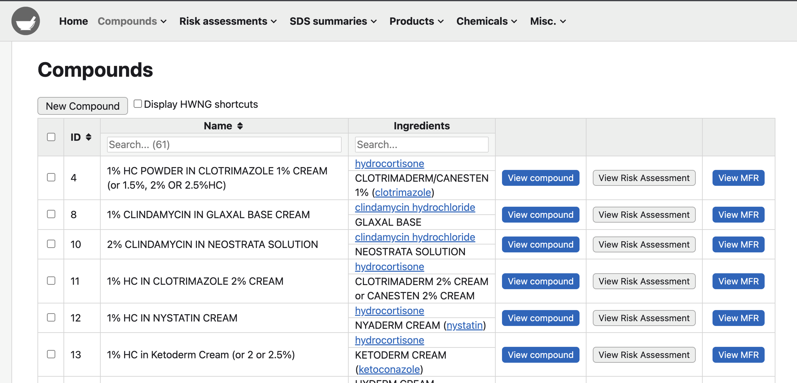
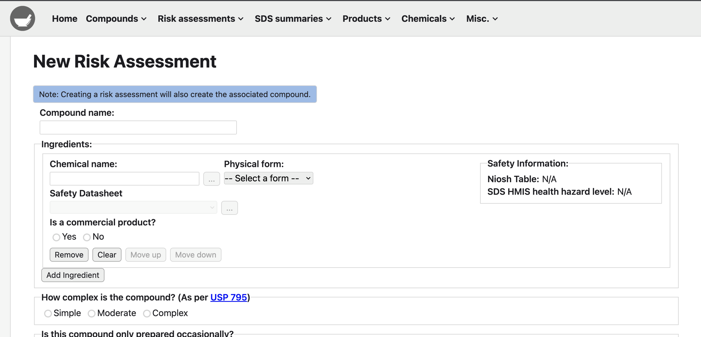
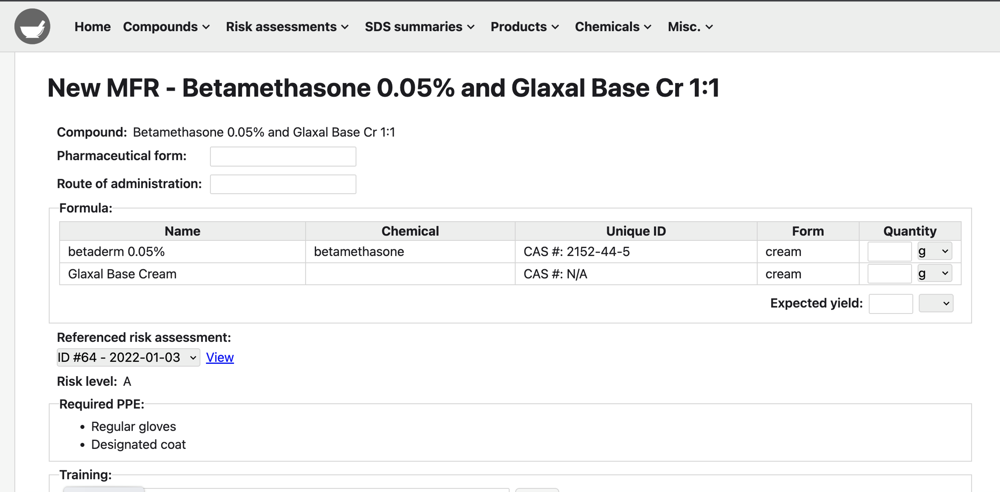
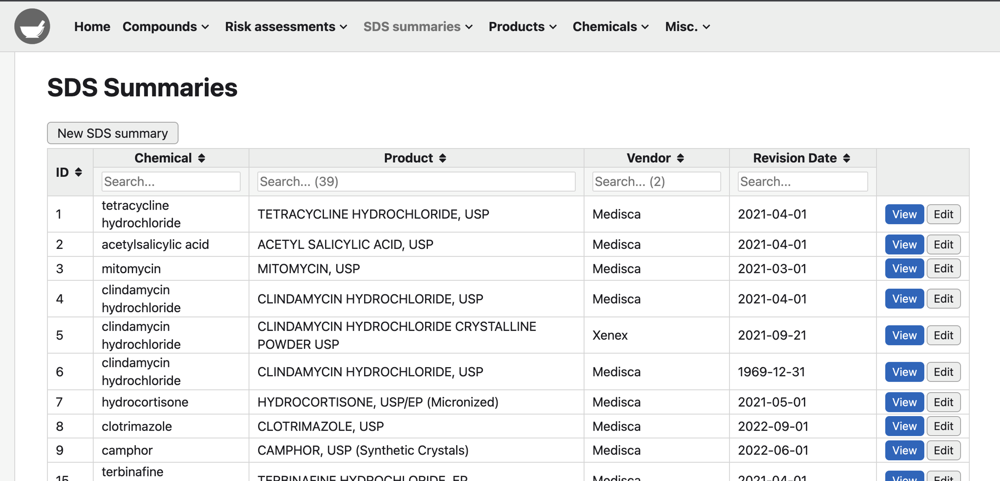

# Compounding Helper

Compounding Helper is a web application for managing the documentation used when pharmacies prepare customized, non-sterile medications.

It brings ingredient information, safety data, risk assessments, and preparation instructions into one system so related records can be reused instead of maintained across separate files.


## Main Workflow

Pharmacy staff can:

- use shared or pharmacy-specific information about ingredients, products, vendors, and safety hazards,
- define compounded medications and their ingredients,
- assess the risks involved in preparing them,
- create and revise approved preparation instructions, and
- manage access for staff across separate pharmacies.

A **Safety Data Sheet (SDS)** describes a product's hazards and safe handling requirements. A **Master Formulation Record (MFR)** contains the approved formula and preparation instructions for a medication.

```mermaid
flowchart LR
    A[Ingredient and product information]
    --> B[Safety data]
    --> C[Compounded medication]
    --> D[Risk assessment]
    --> E[Preparation instructions]
````

## Shared and Pharmacy-Specific Data

Common reference records, such as chemicals, products, vendors, and SDS summaries, can be maintained centrally and reused across pharmacies.

Each pharmacy can also create its own records when the required information is not available globally. Shared records are read-only for individual pharmacies, while local records remain specific to the pharmacy that created them.

## Screenshots


### Linked compounding records

Compounds, ingredients, risk assessments, and preparation records can be viewed from a single searchable list.



### Structured risk assessment

Risk assessments combine ingredient details, safety information, and preparation-specific questions. Creating an assessment also creates the associated compound record.



### Preparation record creation

Master Formulation Records reuse information from the selected compound and risk assessment, including ingredients, risk level, and required protective equipment.



### Safety data management

Safety Data Sheet summaries are stored as searchable records linked to their chemical, commercial product, vendor, and revision date.



## Tech Stack

- **Framework:** Next.js, React, and TypeScript
- **Server-side:** Next.js API routes
- **Database and ORM:** PostgreSQL on Supabase with Prisma
- **Authentication:** Supabase Auth
- **Authorization:** CASL
- **Forms and validation:** React Hook Form and Zod
- **Testing:** Jest

## Data Model

The relational data model allows product, ingredient, safety, assessment, and formulation data to be linked and reused across the workflow.

```mermaid
erDiagram
    Pharmacy ||--o{ User : has
    Pharmacy ||--o{ Compound : owns
    Pharmacy ||--o{ RiskAssessment : owns

    Product }o--|| Chemical : references
    Product }o--|| Vendor : sold_by
    SDS }o--|| Product : describes
    Compound ||--o{ Ingredient : contains
    Ingredient }o--o| SDS : may_reference
    RiskAssessment }o--|| Compound : evaluates
    Mfr }o--|| RiskAssessment : based_on
    Mfr }o--|| Compound : documents
```

## Project Status

The core workflows, authentication, pharmacy-level data separation, and role-based authorization are implemented.

The project is not currently under active development. Automated test coverage is limited.

## Development

The application uses Supabase for PostgreSQL hosting and authentication, with Prisma for database access and migrations.

The repository contains local and remote development configuration, but the complete setup process is not currently documented.

## Referenced Guidance

* [NAPRA — Guidance Document for Pharmacy Compounding of Non-sterile Preparations](https://www.napra.ca/general-practice-resources/guidance-document-pharmacy-compounding-non-sterile-preparations)
* [NIOSH List of Antineoplastic and Other Hazardous Drugs in Healthcare Settings](https://www.cdc.gov/niosh/docs/2016-161/default.html)
* [Globally Harmonized System of Classification and Labelling of Chemicals](https://unece.org/transport/standards/transport/dangerous-goods/ghs-rev9-2021)